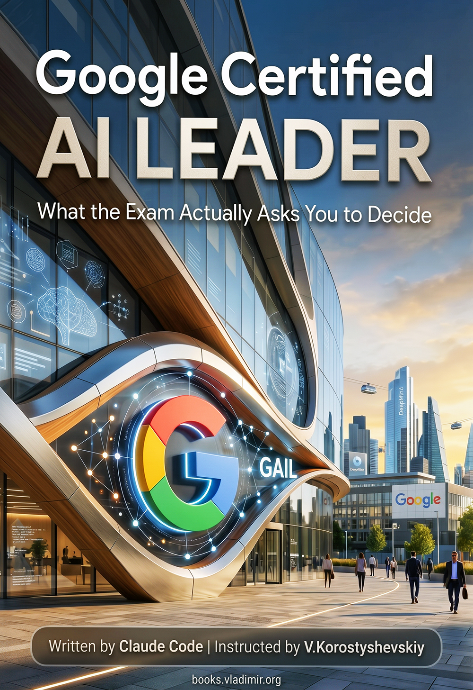

# Google Certified AI LEADER (GAIL)

### What the Exam Actually Asks You to Decide

A practitioner guide for Google Cloud's **Generative AI Leader** certification: 22 chapters, around 43K words, covering all 15 objectives across the four exam sections. Core concepts and the boundaries between them, how a model learns and the lifecycle around it, data you can actually use, the five layers of the landscape, Google's four foundation models, the products from the Gemini app to Agent Platform, agents and what they can reach, the pre-built API shelf, model limitations and their remedies, prompting, grounding, sampling settings, running a deployed model, and the strategy, security and responsibility work a leader actually owns.

The editorial position is this: nearly every wrong answer on this exam is something a competent leader would really do. A technique chosen before the problem was named, a true statement about a product that answers a question nobody asked, half of a two-sided recommendation. Elimination by obvious nonsense, which carries people through a lot of technical exams, does very little here. So the book argues each choice to the point where the boundary between two sensible options is visible, on the theory that reasoning transfers to a scenario nobody has seen and a memorised product list does not.

The other thing worth knowing before you start: **the product documentation cannot settle half of this exam.** `docs.cloud.google.com` documents products thoroughly, and this is a leader exam that spends a third of its weight on judgement. Three objectives, covering prompt engineering, implementation steps and responsible AI, have no product documentation behind them at all. That is also where a guide earns its keep, which is why sections 3 and 4 carry 35% of the exam and more than a third of the chapters.

## How the chapters are built

Every chapter carries the same apparatus in the same order, so you can open one you have not read and know where you are.

It opens with an italic summary naming the decision at stake and what it costs to get wrong. The headers underneath state their conclusions, which makes the header list inside a chapter a usable summary of it. Anything with parallel structure goes into a table instead of a paragraph. Mistakes get names, in bold. A mistake with a name is one you can recognise among options you are seeing for the first time.

Each chapter then takes apart the way wrong answers are constructed from its own material, and closes that section on a three-column table pairing a signal in the question with the answer it normally points to and the trap it normally conceals. The rows are cues, not worked cases, which is what lets them apply to a scenario set in some industry the book never once mentions.

Then a closing list of things to remember, written so each line survives with the chapter shut.

If you are short of time, that closing list is the part to know about. Read all twenty-two of them first, then go back into the chapters behind any line you could not immediately justify.

## Contents

Every chapter below links to its Markdown source. The PDF and EPUB carry the same text.

[**Preface**](./book/chapters/00-preface.md)

**Part I. What this is, and what you are choosing between**

1. [What a Leader Exam Tests, and What It Does Not](./book/chapters/01-what-a-leader-exam-tests.md)
2. [AI, ML and Gen AI Are Nested, and the Order Matters](./book/chapters/02-ai-ml-and-gen-ai-are-nested.md)
3. [Three Ways a Model Learns, and the ML Lifecycle](./book/chapters/03-three-ways-a-model-learns.md)
4. [Data You Can Use Is Not the Same as Data You Have](./book/chapters/04-data-you-can-use.md)
5. [Five Layers, and Which One Owns Your Problem](./book/chapters/05-five-layers.md)
6. [Four Google Models, and the Question That Picks One](./book/chapters/06-four-google-models.md)
7. [Choosing a Model Is Eight Trade-offs, Not One Ranking](./book/chapters/07-choosing-a-model.md)

**Part II. What Google sells, and which surface answers which question**

8. [Seven Claims Google Makes, and the Worry Each Answers](./book/chapters/08-googles-enterprise-claim.md)
9. [The Productivity Surface You Already Own](./book/chapters/09-the-productivity-surface.md)
10. [Customer Experience: Who Is Helped, and When](./book/chapters/10-customer-experience.md)
11. [Ground, Tune or Train on the Platform](./book/chapters/11-building-on-the-platform.md)
12. [What an Agent Is Made Of, and What It Can Reach](./book/chapters/12-what-an-agent-is-made-of.md)
13. [The API Shelf, and Which Studio You Are Standing In](./book/chapters/13-the-api-shelf.md)

**Part III. Making the output better, and knowing that it got better**

14. [Six Limitations, and the Remedy for Each](./book/chapters/14-six-limitations.md)
15. [Prompting: Examples Are Instructions](./book/chapters/15-prompting.md)
16. [Grounding Changes Where the Answer Comes From](./book/chapters/16-grounding.md)
17. [Five Settings That Change the Output, Not the Model](./book/chapters/17-five-settings.md)
18. [A Deployed Model Is a Running System](./book/chapters/18-a-deployed-model-is-a-running-system.md)

**Part IV. Leading it**

19. [Needs Before Tools: Nine Questions to Ask First](./book/chapters/19-needs-before-tools.md)
20. [Two Directions at Once, and How You Prove It Worked](./book/chapters/20-two-directions-at-once.md)
21. [Secure AI Is a Lifecycle Property, Not a Product](./book/chapters/21-secure-ai.md)
22. [Responsible AI Is Four Obligations You Can Name](./book/chapters/22-responsible-ai.md)

**Back matter**: [Coverage Map](./book/chapters/95-coverage-map.md) · [Glossary](./book/chapters/96-glossary.md)

## Why the chapters are not in exam order

The published exam guide lists four sections and fifteen objectives in a fixed order, and this book does not follow it.

Blueprint order is a filing system, and this one files single decisions in several places at once. The word *agent* appears under eight of the fifteen objectives. Grounding is taught once as a product, under Google Cloud's offerings, and again as a technique, under improving model output. Choosing a model is partly in section 1, where the criteria live, and partly in section 4, where the business need does. A reader working through it in order meets a third of the agent decision three times and the whole of it never.

So the chapters run in the order the decisions arrive: what this technology is, what you are choosing between, what Google sells, how to make the output better, and how to lead the thing.

An ordering bet like that is only defensible if it costs no coverage, so the book carries a proof of it. The [Coverage Map](./book/chapters/95-coverage-map.md) is generated from the blueprint and from the book's own structure, and it **fails to build if any objective is unclaimed**, and again if it names a chapter that is not on disk. A second generated check holds the vocabulary: all 184 terms the two Google documents name are assigned to exactly one chapter, and the build fails if a chapter does not actually teach one it owns.

## The four sections

Weights are the published ones. Note that Google publishes a weight per **section** and none per objective, so revising by objective is revising at a granularity the exam guide does not have. Read the chapter numbers as where this book spends its pages.

- **Fundamentals of gen AI** (~30%, Chs [2](./book/chapters/02-ai-ml-and-gen-ai-are-nested.md), [3](./book/chapters/03-three-ways-a-model-learns.md), [4](./book/chapters/04-data-you-can-use.md), [5](./book/chapters/05-five-layers.md), [6](./book/chapters/06-four-google-models.md), [7](./book/chapters/07-choosing-a-model.md)): what sits inside what, and what each layer adds that the one above it does not have. The three learning approaches decided by a single property of the data. Data that is clean, complete and still useless for the thing you are doing. The five layers of the landscape, which are the map the rest of the book runs on. Google's four foundation models, and the one question that picks between them.
- **Google Cloud's gen AI offerings** (~35%, Chs [8](./book/chapters/08-googles-enterprise-claim.md), [9](./book/chapters/09-the-productivity-surface.md), [10](./book/chapters/10-customer-experience.md), [11](./book/chapters/11-building-on-the-platform.md), [12](./book/chapters/12-what-an-agent-is-made-of.md), [13](./book/chapters/13-the-api-shelf.md)): the largest section, and a products inventory rather than a strategy paper. Seven claims Google makes and the worry each one answers. Six places Gemini turns up and how to tell which one a scenario wants. The customer-experience products, separated by who is being helped and when. Ground, tune or train, which is the decision ladder most of this section hangs off. What an agent is made of and what its tools can reach, and the shelf of pre-built APIs you should reach for before a foundation model.
- **Techniques to improve gen AI model output** (~20%, Chs [14](./book/chapters/14-six-limitations.md), [15](./book/chapters/15-prompting.md), [16](./book/chapters/16-grounding.md), [17](./book/chapters/17-five-settings.md), [18](./book/chapters/18-a-deployed-model-is-a-running-system.md)): six named limitations and the specific remedy that addresses each, which is not one-to-one and is where the marks go. Prompting techniques sorted by what each one actually changes. Grounding as a change to where the answer comes from rather than an improvement to the model. The five sampling settings, and the much larger set of complaints no setting can reach.
- **Business strategies for a successful gen AI solution** (~15%, Chs [19](./book/chapters/19-needs-before-tools.md), [20](./book/chapters/20-two-directions-at-once.md), [21](./book/chapters/21-secure-ai.md), [22](./book/chapters/22-responsible-ai.md)): the smallest section by weight, with the least documentation behind it and the most judgement in it. The nine questions Google says to ask before anything gets built. Why half of a two-sided recommendation is the most convincing wrong answer on the exam. Security as a property of the whole lifecycle rather than a product you buy. And responsible AI as four obligations specific enough to tell apart.

Each chapter names the mistakes that wrong answers are built out of, in bold, because a mistake you can name is one you can recognise in an option list you have never seen.

## How it was made

The corpus is Google's own material in a strict order of authority. The published exam guide and study guide, which are the only authority on what is testable. Google Cloud's product documentation, mirrored in October 2026, around 2,700 pages. And Google's own non-product writing, consulted only where the first two are silent.

The order does real work. Where the exam guide and the documentation ever differ, both are reported rather than reconciled, because this rebrand is mid-flight and Google's two documents for this exam genuinely disagree in places: the customer-experience suite has one set of names in the exam guide and another in the study guide, and the book says so rather than picking a side.

Two findings shaped the book more than anything else, and both came out of measuring the sources rather than reading them.

**The blueprint is the menu.** A census of Google's two documents against everything else in circulation found 184 distinct terms in Google's own vocabulary and essentially nothing outside it: the recurring words that appear everywhere else and nowhere in Google's documents come to nine, and all nine are scenario furniture like SQL and CRM. So the book's scope is Google's own 184 terms, and a chapter that teaches something outside them is a chapter that wandered.

**A third of that vocabulary is in the study guide only.** Model Builder, MLOps, LiteRT, Gemini Nano, the reasoning loop, the three agent types, metaprompting, the needs-and-resources list, the six strategy elements: 46 terms the exam guide never names. A guide written from the blueprint alone would miss all of it.

Two of my own tools did the gathering.

- [**site2vault**](https://github.com/vkorost/site2vault) mirrored Google Cloud's documentation into a local Obsidian vault, so the writing read from files instead of paying for web fetches. It also fixes the corpus in place, so the book was written against one specific snapshot and not against whatever the docs happened to say later.
- [**YTubeFetch**](https://github.com/vkorost/ytubefetch) pulled the subtitles from a few dozen YouTube recordings of people describing this exam to each other.

Those recordings ground no sentence in the book. They were read as a list of topics worth having on the table and never as evidence of anything. What a crowd repeats about an exam is a rumour that has been through a lot of mouths, and the useful response to a rumour is to go and look, not to print it. Where the recordings pointed at something, the book went to the documentation and found out.

The book itself was assembled with Claude Code using techniques described in [weekend-diy-book](https://github.com/vkorost/weekend-diy-book): per-chapter assembly under explicit constraints, automated gates on every chapter, generated coverage and vocabulary checks, and a build that refuses to run until all of them pass. Every claim about how something behaves traces to a documentation page, and the endnote carries that page's own URL, so you are never handed a title you then have to go and search for.

## The names changed in April 2026, and the book carries both

At Cloud Next 2026 Google renamed most of the surface this exam covers. Vertex AI became Gemini Enterprise Agent Platform, Vertex AI Search became Agent Search, Vertex AI Studio became Agent Studio, Agentspace became Gemini Enterprise, NotebookLM became Gemini Notebook.

The exam guide uses the new names. A great deal of material still in circulation uses the old ones, and Google's own documentation is mid-transition: the Dialogflow CX pages currently open by noting that some products and features are being renamed. So the book carries **both** names, because nobody outside Google knows whether the exam's own questions were rewritten with the rebrand, and a guide that bet on one answer would be wrong half the time if it bet wrong.

Two products that sound like they belong to the retired generation were not renamed at all, Dialogflow CX and Contact Center AI, and the book says so, because rejecting an option for having a dated-sounding name is pattern-matching rather than knowledge.

## Download

- [**PDF**](https://github.com/vkorost/google-certified-ai-leader-guide/releases/latest/download/Google-AI-Leader-Certification-Guide.pdf) - for offline reading and print.
- [**EPUB**](https://github.com/vkorost/google-certified-ai-leader-guide/releases/latest/download/Google-AI-Leader-Certification-Guide.epub) - for e-readers.

Both are attached to the [latest release](https://github.com/vkorost/google-certified-ai-leader-guide/releases/latest) and always point at the current revision. The book is corrected in place instead of re-versioned, so these links do not go stale.

## What's in this repo

- `README.md`: this file.
- `book/chapters/`: every chapter as an individual Markdown file, plus the preface, the coverage map, and the glossary. Endnotes sit at the end of each chapter that has them, with the source URL in the note. In the built book they are collected into a single appendix, grouped by chapter.
- `book/Google-AI-Leader-Certification-Guide-Cover.jpg`: the cover.
- [`LICENSE`](./LICENSE): CC BY-NC-SA 4.0.

The PDF, EPUB and DOCX are attached to the release instead of committed. All three are already-compressed archives that git cannot delta, so committing them would store a near-complete copy per revision and grow the repository permanently.

The documentation vault, the pipeline, and the working files are not published. Neither is any exam-question material: [Google's certification terms](https://cloud.google.com/certification/terms) place exam content under confidentiality, and nothing of that kind appears in this book, in this repository, or in any file linked from it.

## Coverage cutoff

Documentation sources were consulted through October 2026, and both Google documents are the current published versions. Google Cloud's AI products are under active development and were renamed wholesale five months before this was written, so the naming in particular will keep moving. The text documents behaviour as of its writing date. Verify time-sensitive claims against current documentation before relying on them for a production decision or for the exam.

## AI assistance, scope of

The book was written by Claude Code under my instruction, and the preface says so to the reader rather than burying it down here. Every chapter ran through automated gates covering verbatim overlap with the sources, citation hosts, banned subjects and emphasis discipline, with the orchestrator re-running every check independently instead of trusting a self-report. Editorial decisions about structure, ordering, framing, and which positions to take were mine. Fact-checking was bounded by the source corpus, and the automated gates are what held that boundary.

## What's not in scope

This is not a Google Cloud tutorial, a getting-started guide, or a product reference. It contains no practice questions, no drills, and nothing for you to answer. The reader is assumed to be someone who leads or influences technology decisions, not someone who will implement them: the certification itself puts the expertise in strategic leadership rather than technical implementation, and the book is pitched at that altitude. It does not teach you to build on the platform; it teaches you to choose correctly between options that all sound reasonable, which is what the exam is asking.

If you are after the Anthropic credentials instead, [claude-certified-developer-guide](https://github.com/vkorost/claude-certified-developer-guide) is the same treatment for CCDV-F.

## Disclaimer

This repository is an independent, unofficial study guide. It is not produced, endorsed, sponsored, or reviewed by Google. "Google", "Google Cloud", "Gemini", "Vertex AI" and "Generative AI Leader" are trademarks of Google LLC, used here for descriptive reference only.

## Author

I am not employed by Google or any AI vendor. The book was produced independently and represents no company's views. The analytical framework, the named concepts, and the structural argument are original to this work. The facts are drawn from the cited public corpus.

## License

Everything here (the chapter `.md` files, this README, and the cover) is licensed under **Creative Commons Attribution-NonCommercial-ShareAlike 4.0 International (CC BY-NC-SA 4.0)**. See [`LICENSE`](./LICENSE).

You may share and adapt it for non-commercial purposes with attribution. Commercial reuse or redistribution of the written content, including republication as a book, a course, or any paid resource, is not permitted, and any derivative must carry the same license.

---

